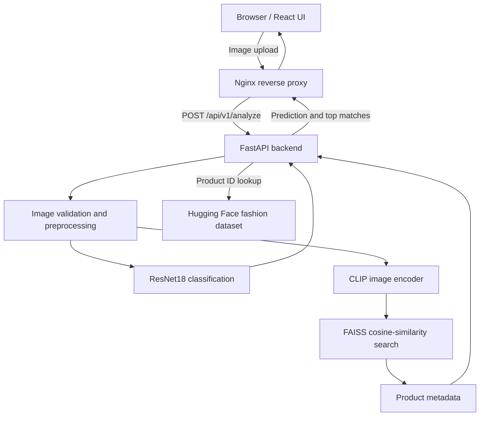

# ShopSense AI

**Multimodal E-Commerce Product Intelligence Platform**

ShopSense AI is an end-to-end machine learning application that classifies uploaded fashion-product images and retrieves visually similar catalog items. It combines a fine-tuned ResNet18 classifier, pretrained CLIP image embeddings, FAISS vector search, a FastAPI service, and a React/TypeScript interface.

> **Project scope:** Portfolio MVP demonstrating applied machine learning, model evaluation, API integration, and containerized delivery. It is not a production e-commerce service.

## Features

- **Image classification:** Predict one of four product categories: Apparel, Accessories, Footwear, or Personal Care.
- **Visual retrieval:** Encode an uploaded image with CLIP and search a FAISS index for similar catalog products.
- **Product previews:** Serve retrieved product images using dataset product IDs, without accepting arbitrary filesystem paths from clients.
- **Interactive interface:** Drag-and-drop upload, preview, validation, loading/error states, predicted category, and top-five retrieval results.
- **Containerized application:** React/Nginx frontend and FastAPI backend orchestrated with Docker Compose.
- **Automated checks:** GitHub Actions workflow for backend tests, frontend build, and Docker Compose configuration validation.

## Architecture



**Inference flow:** The API validates an uploaded image, predicts its broad category with ResNet18, creates a normalized CLIP image embedding, searches the FAISS index, and returns ranked product metadata and image endpoints. The classification and retrieval results are separate outputs; the classifier does not filter the FAISS search results.

## Tech Stack

| Layer | Technologies |
| --- | --- |
| Classification | Python, PyTorch, Torchvision, ResNet18 |
| Embeddings and retrieval | OpenAI CLIP ViT-B/32, FAISS |
| Dataset processing | Hugging Face Datasets, Pandas, NumPy |
| Backend | FastAPI, Pydantic, Uvicorn |
| Frontend | React, TypeScript, Vite |
| Deployment | Docker, Docker Compose, Nginx |
| CI | GitHub Actions, pytest, npm build |

## Dataset and ML Evaluation

The project uses [`ashraq/fashion-product-images-small`](https://huggingface.co/datasets/ashraq/fashion-product-images-small). Following preprocessing and duplicate/conflict handling, the evaluation dataset contains **43,161 items** across disjoint training, validation, and test splits.

| Split | Items |
| --- | ---: |
| Train | 30,212 |
| Validation | 6,474 |
| Test | 6,475 |

### ResNet18 classification

A pretrained ResNet18 backbone with a trained four-class classification head was evaluated on the held-out test split.

| Test metric | Result |
| --- | ---: |
| Accuracy | **98.61%** |
| Macro F1 | **97.94%** |

See `experiments/resnet18_test_report.txt` for the detailed evaluation output.

### CLIP + FAISS retrieval

The retrieval system uses pretrained `openai/clip-vit-base-patch32`, normalized 512-dimensional image embeddings, and a FAISS `IndexFlatIP` gallery built from **30,212 training items**.

| Test metric | Result |
| --- | ---: |
| Precision@1 | **83.52%** |
| Precision@5 | **80.16%** |
| Hit@5 | **95.57%** |
| MRR@5 | **0.8844** |

**Evaluation caveat:** Retrieval relevance is defined by matching the dataset's `articleType` field. These scores measure agreement with that proxy label, **not human-rated visual similarity**. Exact image hashes and product IDs were separated across splits; exhaustive near-duplicate detection was not established.

## API

| Endpoint | Method | Purpose |
| --- | --- | --- |
| `/health` | GET | Service health |
| `/ready` | GET | Model/service readiness |
| `/api/v1/analyze` | POST | Image classification and similar-product retrieval |

`POST /api/v1/analyze` accepts a multipart image file and a `top_k` query parameter (default 5). JPEG, PNG, and WebP uploads are supported, with a 5 MB upload limit.

Example:

```bash
curl -X POST "http://localhost:8000/api/v1/analyze?top_k=5" \
  -F "file=@/path/to/product.jpg"
```

The API returns classification details, retrieval results, and processing time. Interactive API documentation is available at `http://localhost:8000/docs` when the backend is running.

## Running with Docker Compose

**Prerequisites:** Docker Desktop or Docker Engine with Compose, internet access for first-time Hugging Face downloads, and the model/index artifacts listed below.

The following files must exist locally before starting the service:

```text
models/resnet18_baseline.pth
data/processed/clip_full_faiss.index
data/processed/clip_full_metadata.csv
```

These artifacts are generated by the project's ML workflow and are not assumed to be included in a fresh Git clone. Prepare or obtain them through the project's training and indexing scripts before running the application. The first container startup may also download CLIP weights and the source dataset; allow additional time and disk space.

From the repository root:

```bash
docker compose up -d --build
```

Open **http://localhost:3000**. The FastAPI backend is exposed at **http://localhost:8000**.

Check status and logs:

```bash
docker compose ps
docker compose logs -f backend
```

Stop the application:

```bash
docker compose down
```

Docker Compose mounts `models/` and `data/processed/` read-only and persists the Hugging Face cache in a named volume. The backend image is intended for CPU inference; Docker GPU acceleration is not required.

## Local Development

Use a compatible Python environment with the project's backend dependencies and required ML artifacts. From the repository root:

```bash
python -m uvicorn backend.app.main:app --reload --port 8000
```

In another terminal:

```bash
cd frontend
npm ci
npm run dev
```

The development frontend defaults to `http://localhost:8000` for API calls. Set `VITE_API_BASE_URL` if your backend runs elsewhere. The production frontend uses same-origin `/api/` requests through Nginx when no override is supplied.

## API Latency Benchmark

A local **warm, sequential HTTP benchmark** measured 30 requests after five warm-up requests against the Dockerized CPU backend.

| Metric | Measured value |
| --- | ---: |
| Average latency | **156.67 ms** |
| P50 latency | **151.55 ms** |
| P95 latency | **193.29 ms** |
| Minimum | 124.94 ms |
| Maximum | 198.30 ms |
| Sequential completion rate | **6.38 requests/s** |

The measurements include the HTTP request/response and application processing for the selected image. They do **not** measure concurrent load, cold startup, or production throughput. Results are hardware-, image-, and environment-dependent.

To repeat the benchmark against a running backend:

```bash
python -m pip install requests
python experiments/benchmark_api.py --image /path/to/product.jpg --runs 30 --warmup 5
```

## Tests and Continuous Integration

Run backend tests locally:

```bash
python -m pip install pytest httpx
python -m pytest backend/tests -q
```

Build the frontend:

```bash
cd frontend
npm ci
npm run build
```

Validate Docker Compose:

```bash
docker compose config -q
```

The GitHub Actions workflow at `.github/workflows/ci.yml` runs these categories of checks on pushes and pull requests targeting `main`. The workflow is not an end-to-end ML evaluation and does not download the entire dataset for CI.

## Limitations and Future Work

- The classifier predicts broad categories and can disagree with the more fine-grained retrieval results.
- Retrieval metrics use `articleType` proxy relevance rather than human similarity judgments.
- Product-image serving depends on availability of the source dataset and its cache.
- The initial dataset/model download can increase cold-start time.
- Current benchmarks describe local, sequential CPU requests; concurrency and production load testing remain future work.
- Potential extensions include text-to-image search, richer catalog metadata, and deployment monitoring.

## Project Purpose

ShopSense AI was built to demonstrate the complete applied-AI workflow: dataset preparation, model evaluation, embedding-based retrieval, API design, frontend integration, Docker deployment, and repeatable engineering checks.
